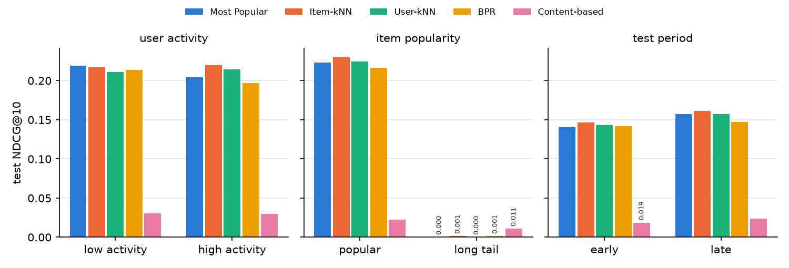
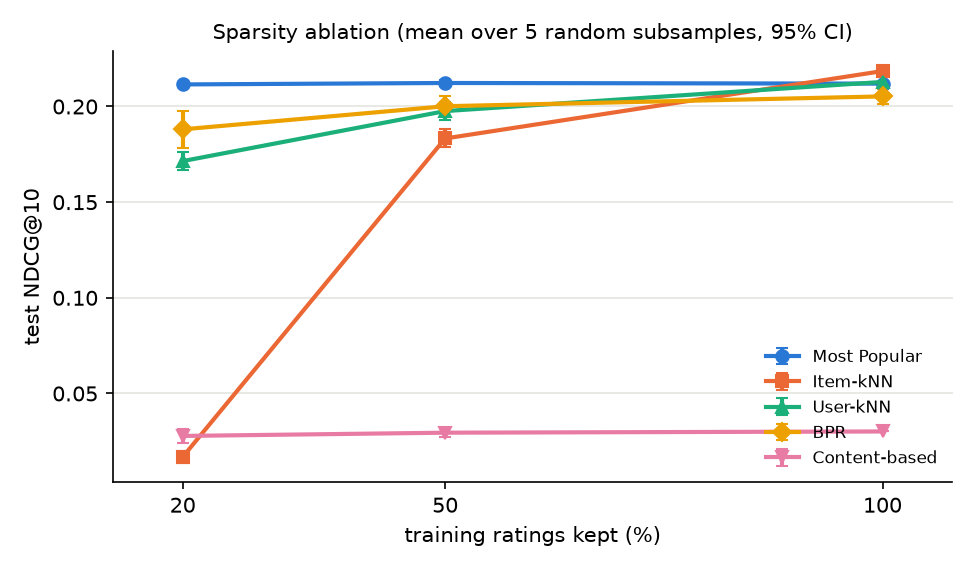

# Recommender Systems Course Project — Group 1

MovieLens 1M recommender project, Parts 1 and 2. Team: Farzana, Berk Peker, Emil.
Report and results workbook: `results/(Group 1) Recommender_Systems_*`.
Decisions and open questions: `docs/PLAN.md`. Part 2 explained step by step: `docs/PART2_WALKTHROUGH.md`.

## Quick start: reproduce everything

**1. The data.** MovieLens 1M is included in `data/ml-1m/` (from https://grouplens.org/datasets/movielens/1m/).
The program reads it from there by default; another location can be given with `--data-dir`.

**2. Run one command** from the repository folder:

```bash
uv run --python 3.11 --with-requirements requirements.txt run_all.py
```

This downloads Python 3.11 if needed, installs the exact package versions from `requirements.txt` and
runs the whole project (about 5 minutes: Part 1 ~15 s, Part 2 ~5 min). It needs
[uv](https://docs.astral.sh/uv/getting-started/installation/):
`curl -LsSf https://astral.sh/uv/install.sh | sh` (macOS/Linux) or
`powershell -c "irm https://astral.sh/uv/install.ps1 | iex"` (Windows).

<details><summary>Without uv (plain Python 3.11 and pip)</summary>

```bash
python3.11 -m venv .venv
source .venv/bin/activate          # Windows: .venv\Scripts\activate
pip install -r requirements.txt
python run_all.py
```

</details>

**Output:** everything in `results/` (CSV tables, figures in `results/figures/`, log in `results/logs/run.log`).
The run is deterministic, so it regenerates the committed files exactly.

**Tests:** `uv run --python 3.11 --with-requirements requirements.txt -m pytest tests -q`

## Libraries used

Python 3.11.17. All versions are pinned in `requirements.txt`.

| Library    | Version | What we use it for                                                   |
| ---------- | ------- | -------------------------------------------------------------------- |
| numpy      | 2.4.6   | arrays and maths                                                     |
| pandas     | 3.1.0   | reading, splitting and writing tables                                |
| scipy      | 1.17.1  | sparse user × movie matrices; t-distribution for 95% CIs             |
| matplotlib | 3.11.2  | all figures                                                          |
| pytest     | 9.2.0   | unit tests only                                                      |
| ruff       | 0.17.3  | code formatting only (`ruff format .`, settings in `pyproject.toml`) |

**No recommender-system library is used.** All models, the split and all metrics are our own code.

## Part 1 in short: data, protocol, baselines

- **Data:** 6,040 users, 3,883 movies, 1,000,209 ratings, density 4.47% (4.26% over the full catalogue).
  Strong long tail: the 10% most rated movies get 45.7% of all ratings, the 20% most rated get 66.7%;
  623 movies have fewer than 10 ratings. Bursty timestamps: 58.7% of users entered all their ratings on a
  single day.
- **Protocol:** global temporal split 80/10/10 (train → 2000-12-02, validation → 2000-12-29, test after).
  A rating of 4–5 stars counts as relevant. Users need ≥ 5 training ratings to be evaluated. Every model
  ranks the full catalogue. Metrics: P@10, R@10, NDCG@10 (with 95% CI) and catalogue coverage.
- **Baselines (test NDCG@10):** item-kNN (adjusted cosine, k = 50, tuned on validation) 0.219;
  Most Popular, 3 variants: all ratings 0.200, last 90 days 0.202, 4–5 stars only 0.212.

## Part 2: what we added

### Three new models, all self-implemented (no library code)

| model         | file                          | paradigm         | idea                                                                      | lecture              |
| ------------- | ----------------------------- | ---------------- | ------------------------------------------------------------------------- | -------------------- |
| User-kNN      | `src/models/user_knn.py`      | neighbourhood CF | find the most similar users; recommend what they rated                    | 1.2, slides 5–10     |
| BPR-MF        | `src/models/bpr.py`           | ranking-loss CF  | learn user and movie vectors so a rated movie scores above an unrated one | 2.1, slides 4, 11–12 |
| Content-based | `src/models/content_based.py` | content-based    | user profile from the genres and decade of rated movies; cosine match     | 2.2, slides 4–7      |

All models share one interface (`fit`, `score`, `params`) in `src/models/base.py`.

### Why these three

The assignment lists seven paradigms; two models from the same paradigm count as one.

| paradigm         | examples given in the assignment                                       | lecture             | our choice    |
| ---------------- | ---------------------------------------------------------------------- | ------------------- | ------------- |
| neighbourhood CF | user-based kNN; item-kNN with another similarity or normalization      | 1.2, slides 5–10    | User-kNN      |
| latent-factor CF | matrix factorization with biases and regularization; the same with ALS | 2.1, slides 4, 7–9  | –             |
| ranking-loss CF  | BPR or another pairwise objective                                      | 2.1, slides 11–12   | BPR-MF        |
| content-based    | profile matching over genre and release-year metadata                  | 2.2, slides 4–7     | Content-based |
| hybrid           | weighted, switching, cascade, feature combination, meta-level          | 2.2, slide 10       | –             |
| neural           | autoencoder or Mult-VAE; two-tower                                     | 3.2, slides 7, 9–10 | –             |
| sequential       | Markov chains; session-kNN; GRU4Rec; SASRec                            | 4.1, slides 6, 8–9  | –             |

Roughly from simple to complex: kNN, content-based, weighted hybrid and Markov chains are the simplest;
matrix factorization and BPR are in the middle (user and movie vectors learned with SGD); neural and
GRU4Rec/SASRec models are the most complex (a deep-learning library, long training, many settings).

- **User-kNN:** the simplest neighbourhood model and the mirror of the Part 1 item-kNN (it compares users
  instead of movies), so the two can be compared directly.
- **BPR instead of plain matrix factorization:** the same difficulty, but MF predicts the star rating, while
  BPR learns the order of movies. Our task is a top-10 ranking, so BPR fits it better.
- **Content-based:** uses no other users, so it is a truly different paradigm, and it is the only model that
  can recommend long-tail movies. Its genre vectors can be reused in Part 3.

We took the simplest model of three different paradigms: the assignment grades an honest comparison,
not model complexity.

### Fair comparison

- **Same tuning budget:** every model family tries 15 settings on validation (Most Popular: its 3
  variants), the best is refitted on train + validation and tested once. Grids are in `config.py`.
- **Intervals:** each model is compared with item-kNN user by user (paired difference of NDCG@10, mean ±
  95% CI). BPR depends on its random start, so it is tested with 5 seeds (42–46).

| model                    | best setting (validation)         | NDCG@10 ± 95% CI | coverage | vs item-kNN (paired)  |
| ------------------------ | --------------------------------- | ---------------- | -------- | --------------------- |
| Item-kNN (Part 1)        | adjusted cosine, k = 50           | 0.219 ± 0.014    | 14.3%    | –                     |
| User-kNN                 | Pearson, k = 200                  | 0.213 ± 0.014    | 8.1%     | −0.006 ± 0.010 (n.s.) |
| Most Popular (4–5 stars) | –                                 | 0.212 ± 0.014    | 3.6%     | −0.007 ± 0.009 (n.s.) |
| BPR-MF (mean of 5 seeds) | 64 factors, 10 epochs, reg 0.03   | 0.205 ± 0.013    | 15.2%    | −0.013 ± 0.009        |
| Content-based            | centred profile, year weight 0.25 | 0.030 ± 0.005    | 43.3%    | −0.188 ± 0.014        |

n.s. = the interval contains 0, so there is no real difference. **No new model beats item-kNN.**

### Disaggregated results (`src/evaluation/disaggregate.py`)

Test NDCG@10 split by user activity (≤ / > 150 training ratings), item popularity (top 20% of movies vs
long tail) and test period (before / from 2001-06-20).

| model         | low-activity users | high-activity users | popular items | long-tail items | early test | late test |
| ------------- | ------------------ | ------------------- | ------------- | --------------- | ---------- | --------- |
| Most Popular  | 0.219              | 0.205               | 0.223         | 0.000           | 0.141      | 0.157     |
| Item-kNN      | 0.217              | 0.220               | 0.230         | 0.001           | 0.147      | 0.162     |
| User-kNN      | 0.211              | 0.214               | 0.224         | 0.000           | 0.143      | 0.157     |
| BPR           | 0.214              | 0.197               | 0.216         | 0.001           | 0.142      | 0.147     |
| Content-based | 0.030              | 0.030               | 0.022         | 0.011           | 0.019      | 0.024     |

Most Popular is best for low-activity users. On the long tail all collaborative models score about 0;
only content-based finds some long-tail movies.



### Sparsity ablation

Training ratings randomly subsampled to 50% and 20% (5 seeds each); test users stay the same.

| model         | 100%  | 50%   | 20%   |
| ------------- | ----- | ----- | ----- |
| Item-kNN      | 0.219 | 0.183 | 0.017 |
| User-kNN      | 0.213 | 0.198 | 0.171 |
| Most Popular  | 0.212 | 0.212 | 0.212 |
| BPR           | 0.205 | 0.200 | 0.188 |
| Content-based | 0.030 | 0.030 | 0.028 |

**The winner collapses:** item-kNN is first on full data and last at 20% (0.017, below even content-based). With few ratings, rare
movies get "perfect" similarities from two or three co-ratings by chance (Lecture 1.2, slide 10); at 20%
its recommended movies have a median of 4 training ratings (1,631 on full data). Most Popular is not
affected and ranks first at 50% and 20%.



### New files

- Models: `src/models/user_knn.py`, `bpr.py`, `content_based.py`
- Pipeline: `src/experiments/run_part2.py`, `src/evaluation/disaggregate.py`, `src/plot_part2.py`
- Tests: `tests/test_models.py` (each model checked against a hand-calculated example)
- Results: `results/part2_models.csv`, `part2_disaggregated.csv`, `part2_sparsity.csv`,
  `results/figures/part2_*.png`; every validation and test run is also in `results/results.csv`

## Reproducibility details

- Seed: `SEED` in `config.py` (42). BPR's test run and the sparsity subsamples use `SEEDS` (42–46).
- Split fractions, filtering thresholds and every tuning grid: `config.py`.
- No intermediate files are needed: the split and all results are regenerated by `run_all.py`.

## Use of AI assistants

Disclosed in the report ("Use of AI Assistants"), as required by the assignment.
