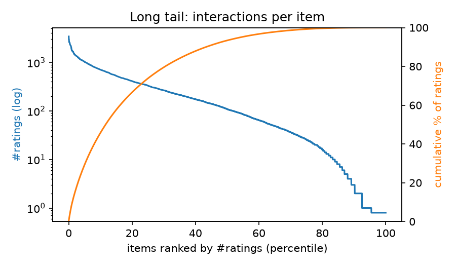
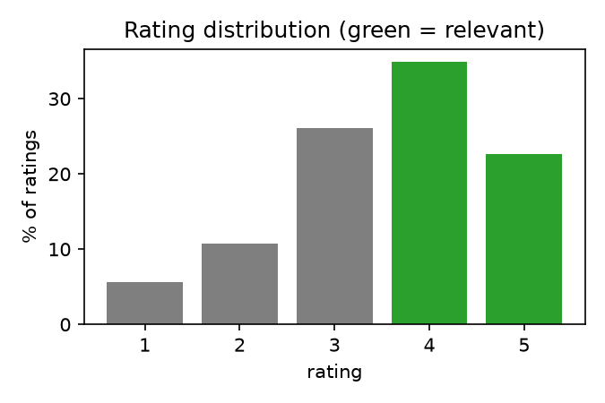
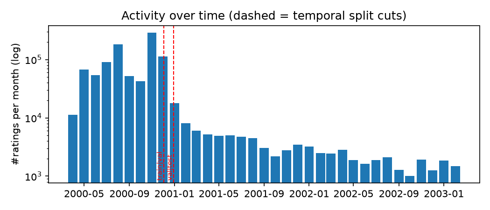

# Recommender Systems Course Project — Group 1

> STATUS: Part 1 implemented (`python run_all.py --data-dir data/ml-1m`).
> What the project is about, what each part requires, and the options for Parts 2–3: `docs/PROJECT_OVERVIEW.md`.
> Decisions and open questions: `docs/PLAN.md`.

Part 1: data characterisation, temporal evaluation protocol and two baselines (Most Popular,
item-based kNN) on MovieLens 1M.
Report and results workbook: `results/(Group 1) Recommender_Systems_*` · Team: Farzana, Berk Peker, Emil

## Results (Part 1)
_Numbers from `python run_all.py`; update this section by hand if the results change._

### 1. The data
|  | value |
|---|---|
| users | 6,040 |
| movies (catalogue / ever rated) | 3,883 / 3,706 |
| ratings | 1,000,209 |
| density | 4.47% |
| ratings that are 4–5 stars (= relevant) | 57.5% |
| share of ratings on the top 20% of movies | 66.7% |
| movies with < 20 ratings | 21.6% |
| time span | 2000-04-25 → 2003-02-28 |




### 2. Temporal split
| split | period | ratings | users | users evaluated |
|---|---|---|---|---|
| train | → 2000-12-02 | 800,164 | 5,400 | – |
| validation | 2000-12-02 → 2000-12-29 | 100,024 | 1,134 | 490 |
| test | 2000-12-29 → | 100,021 | 1,209 | 1,154 |



### 3. Baselines on the test set
| model | P@10 | R@10 | NDCG@10 ± 95% CI | coverage |
|---|---|---|---|---|
| Popular (all ratings) | 0.185 | 0.052 | 0.200 ± 0.014 | 3.8% |
| Popular (last 90 days) | 0.187 | 0.054 | 0.202 ± 0.014 | 3.2% |
| Popular (4–5 stars only) | 0.195 | 0.057 | 0.212 ± 0.014 | 3.6% |
| Item-kNN | 0.200 | 0.065 | 0.219 ± 0.014 | 14.3% |

### 4. Item-kNN tuning (validation)
Chosen: **adjusted cosine, k = 50** (validation NDCG@10 = 0.127).

<details><summary>All tuning runs</summary>

| similarity | k | NDCG@10 | P@10 | coverage |
|---|---|---|---|---|
| cosine | 10 | 0.0937 | 0.0796 | 17.1% |
| cosine | 20 | 0.0905 | 0.0741 | 17.3% |
| cosine | 50 | 0.0921 | 0.0790 | 17.2% |
| cosine | 100 | 0.0965 | 0.0822 | 16.2% |
| cosine | 200 | 0.1012 | 0.0906 | 14.8% |
| Jaccard | 10 | 0.1037 | 0.0855 | 14.2% |
| Jaccard | 20 | 0.1014 | 0.0855 | 14.0% |
| Jaccard | 50 | 0.0984 | 0.0876 | 13.6% |
| Jaccard | 100 | 0.1030 | 0.0902 | 12.5% |
| Jaccard | 200 | 0.1058 | 0.0945 | 11.4% |
| adjusted cosine | 10 | 0.1161 | 0.0945 | 13.2% |
| adjusted cosine | 20 | 0.1137 | 0.0957 | 11.8% |
| adjusted cosine | 50 | 0.1266 | 0.1074 | 10.3% |
| adjusted cosine | 100 | 0.1249 | 0.1116 | 9.5% |
| adjusted cosine | 200 | 0.1260 | 0.1116 | 8.7% |

</details>

### 5. Sensitivity to the user filter (test NDCG@10)
| model | ≥ 1 train ratings | ≥ 5 train ratings | ≥ 20 train ratings |
|---|---|---|---|
| Item-kNN | 0.2183 | 0.2185 | 0.2178 |
| Popular (all ratings) | 0.2008 | 0.2003 | 0.1966 |
| Popular (4–5 stars only) | 0.2121 | 0.2119 | 0.2067 |
| Popular (last 90 days) | 0.2022 | 0.2018 | 0.1983 |
## 1. Requirements

- Python 3.11.17
- `python3.11 -m venv .venv && source .venv/bin/activate`
  (or with uv: `uv venv --python 3.11 .venv && source .venv/bin/activate`)
- `pip install -r requirements.txt` (all versions pinned)

## 2. Data

MovieLens 1M is NOT included in the repository (GroupLens usage terms).
Download it from https://grouplens.org/datasets/movielens/1m/ and unzip it so that
`data/ml-1m/ratings.dat` and `data/ml-1m/movies.dat` exist.

## 3. Reproduce everything (one command)

```bash
python run_all.py --data-dir data/ml-1m
```

Produces: `results/results.csv` (course template schema), `results/figures/*.png`,
`results/eda_stats.json`, `results/part1_item_knn_grid.csv`, `results/part1_sensitivity.csv`,
`results/logs/run.log`. Expected runtime on a laptop: ≈ 20 s (Apple M-series).

Metric unit tests: `python -m pytest tests -q`

## 4. Reproducibility details

- Seed: `SEED` in `config.py` (42).
- Split: global temporal split, cut points in `config.py` and printed in the log.
- Filtering thresholds, k-grid, similarity grid: `config.py`.
- No intermediate files are needed: the split and all results are regenerated.

## 5. Repository structure

```
run_all.py               single entry point
config.py                every tunable constant (seed, split, thresholds, grids)
src/data/load.py         parse ml-1m (:: separated)
src/eda.py               dataset characterisation + plots
src/split.py             temporal train/val/test + user filtering
src/models/              Most Popular, item-kNN (base.py is commented out until Part 2)
src/evaluation/          metrics, full-catalogue evaluator, confidence intervals
src/experiments/part1.py runs the whole Part 1 pipeline
src/results.py           writes results in the mandatory template schema
tests/                   metric unit tests (vs. Lecture 3.1 slide 8 worked example)
docs/                    plan, code walkthrough, team split
```

## 6. Report ↔ output mapping

| Report item                                    | Output file                                              | Produced by              |
| ---------------------------------------------- | -------------------------------------------------------- | ------------------------ |
| Table: dataset statistics                      | results/eda_stats.json                                   | src/eda.py               |
| Fig: long tail (interactions per item/user)    | results/figures/long_tail_items.png, long_tail_users.png | src/eda.py               |
| Fig: rating distribution                       | results/figures/rating_dist.png                          | src/eda.py               |
| Fig: activity over time + split cuts           | results/figures/activity_over_time.png                   | src/eda.py               |
| Table: split sizes + user filtering            | results/eda_stats.json (`split`), results/logs/run.log   | src/split.py             |
| Table: item-kNN tuning grid (validation)       | results/part1_item_knn_grid.csv                          | src/experiments/part1.py |
| Table: Part 1 baselines                        | results/results.csv                                      | src/experiments/part1.py |
| Table: sensitivity to user filtering           | results/part1_sensitivity.csv                            | src/experiments/part1.py |

## 7. Use of AI assistants

Disclosed in the report (section "Use of AI"), as required by the brief.
